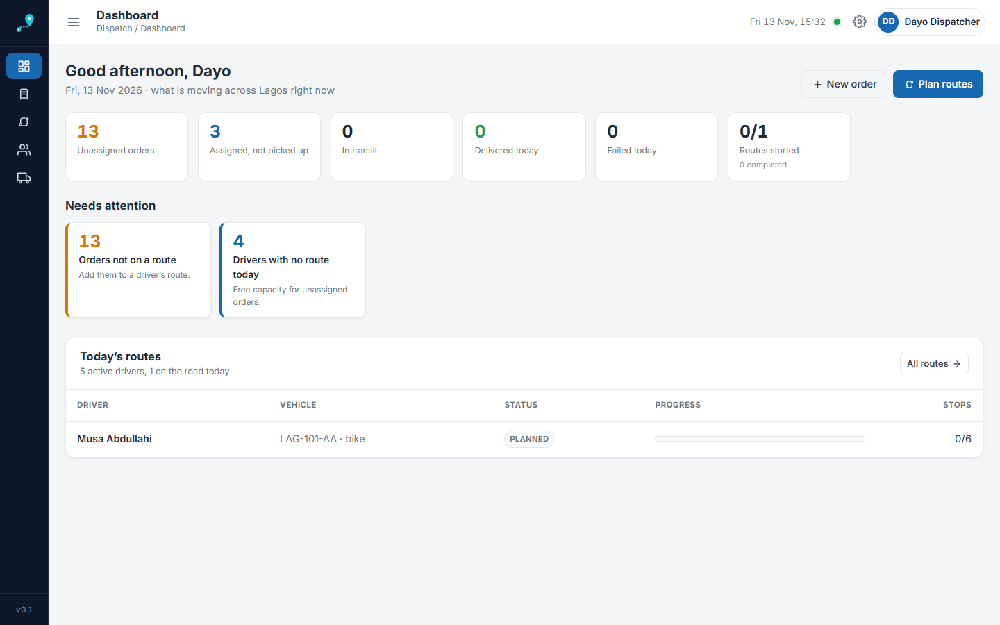
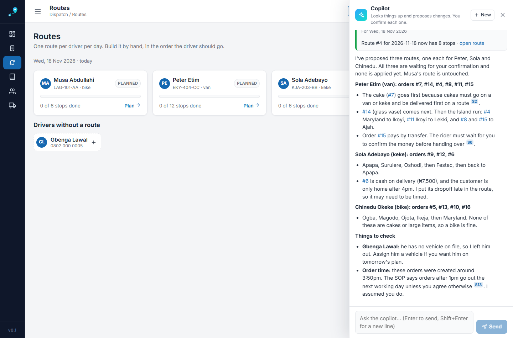
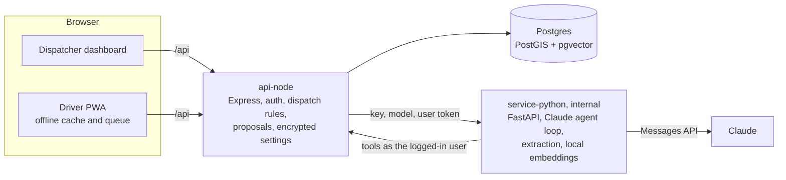

# Logistics Routing

Dispatch software for small and mid-sized courier companies in Nigeria.
It replaces the usual setup, where a dispatcher sends each driver their
jobs over WhatsApp and phone calls, with a web dashboard and an
installable driver app that keeps working when the network drops.

The project is being built in phases, from manual dispatch up to an
LLM-powered dispatch assistant, route optimization and live tracking.
**Phases 1 and 2 are done**: manual dispatch with an offline driver app
tested on a real Android phone, and an AI layer built on FastAPI and Claude
with structured extraction, a tool-using dispatch copilot, and retrieval
over company procedures and driver notes, each measured by evals in this
repo.

| Dispatcher dashboard | Driver app (PWA) |
| --- | --- |
|  |  |




## What it does today

**Dispatchers** (web dashboard)
- Create orders with customer details, pickup and dropoff. With a Google
  Maps key, addresses come from Places search and fill the coordinates.
- Plan each driver's day by hand: add orders to a route, drag stops into
  order, and get warned about a dropoff placed before its pickup. The
  planner shows straight-line distance and a map of the route.
- Follow every order through a timeline built from the driver's updates.
- Manage drivers (with app PINs), vehicles and staff accounts. Admins set
  the Google Maps key, the Anthropic key and the model from the Settings
  page.

**AI layer**
- **WhatsApp intake:** paste a customer's message (Pidgin and forwarded
  chats are fine) and get a draft order with the phone normalised to
  `+234`, checked by a Pydantic schema. The dispatcher reviews it in the
  normal order form before anything is saved.
- **Dispatch copilot:** a chat panel that answers questions and acts
  through 12 tools wrapping the API (drivers, orders, routes, knowledge
  search, and five write tools). Writes are only ever proposed: each one
  shows as a card with Confirm and Reject, and only a confirmation applies
  it. Ask it to plan the whole day and it proposes one route per free
  driver, keeping cakes off bikes.
- **Knowledge search:** company SOPs and drivers' notes on stops (gate
  codes, landmarks, cash to collect), embedded locally and searched with
  pgvector plus keyword ranking. The copilot cites what it used, like [S1].

**Drivers** (installable PWA at `/driver`, no app store)
- Log in with phone number and PIN and see today's stops in order, with
  call and navigate buttons.
- Mark stops arrived, picked up, en route, delivered, or failed.
- Keep working offline. The route is cached on the phone, and taps are
  queued with the time they happened and sent when the connection is back.

## Architecture



- **web**: React, TypeScript and Vite. One app serves the dashboard at `/`
  and the driver PWA at `/driver` (vite-plugin-pwa, Workbox).
- **api-node**: Express API, the only service the browser talks to. JWT
  auth for staff and drivers, zod validation, Postgres through `pg`.
- **Postgres with PostGIS**: locations stored as `GEOGRAPHY(POINT, 4326)`
  from day one, so the optimizer and live tracking need no migration.
- **service-python**: FastAPI, internal only, with no published port. It
  runs the Claude calls (official `anthropic` SDK), the copilot's agent
  loop, and a local embedding model (`BAAI/bge-small-en-v1.5` through
  fastembed). It is stateless: api-node sends the key, model and the
  user's token with every request.

### Design decisions worth a look

- **Offline updates are safe to retry.** Each tap carries a
  `client_event_id`, so a resend after a dropped connection is a no-op.
  The tap time is kept as the event time, and it's clamped in SQL so a
  phone with a wrong clock can't put events before the order's last one.
- **The same rules run on the phone and the server.** The driver app
  applies a tap locally with the API's rules, such as no dropoff before
  pickup, so the screen stays right while offline. The server checks the
  same rules again when the tap arrives.
- **Order and route status are derived.** Drivers only change stops. The
  order's status (assigned, picked up, en route, delivered) and the route's
  status follow from them, so the two can't disagree.
- **The agent can never do more than the user.** Every copilot tool call
  goes to api-node with the logged-in user's own token, so the same auth
  and validation apply as in the dashboard. Write tools only create a
  proposal in `agent_actions`; confirming it makes api-node call its own
  public endpoints as that user. The next turn tells the model what was
  confirmed or rejected, so it never assumes a change happened.
- **Secrets stay on the server.** The Anthropic key is entered in the UI,
  stored encrypted with AES-256-GCM, and never sent back: the API returns
  a masked hint only. Tests check it appears in no response.
- **Search finds exact words and loose questions.** Knowledge search merges
  pgvector similarity and Postgres full-text ranking with reciprocal rank
  fusion, so "gate code 4471" and "what do I tell estate security" both
  work. Embeddings run locally: no second API key and no cost per search.
- **Tests get throwaway databases.** Each test file builds its own Postgres
  database from `db/init` and drops it afterwards, so tests can't touch dev
  data and test files can run in parallel.

## Roadmap

| Phase | Scope | Status |
| --- | --- | --- |
| 1. Manual dispatch | Auth, CRUD, manual routes, offline driver PWA, Lagos seed data | Done, tested on a Pixel 7 Pro (install, offline queue, sync) |
| 2. AI layer | WhatsApp message to validated order (Pydantic structured output), dispatch copilot agent with tool calls and human confirmation of every write, RAG over driver notes and SOPs with pgvector, evals in the repo | Done, evals below |
| 3. Route optimization | OR-Tools vehicle routing with pickup before dropoff, capacity and time windows, compared against the manual plan | Planned |
| 4. Live tracking | Driver location, WebSocket updates, live map, ETAs, customer SMS tracking link | Planned |
| 5. Traffic-aware routing | Road distances and durations, Lagos rush-hour profiles | Planned |
| 6. Multi-tenant SaaS | Row level security per company, Paystack billing | Planned |
| 7. Native driver app | React Native (Expo) for background location and push | Planned |

The full scope and exit criteria for every phase are in [CLAUDE.md](CLAUDE.md).

## Run it locally

Needs Docker and Node 22.

```sh
cp .env.example .env          # set JWT_SECRET to a long random string
docker compose up -d --build  # Postgres (PostGIS, pgvector), api-node, service-python
docker compose exec api-node npm run seed    # demo Lagos data

cd web
npm install
npm run dev                   # http://localhost:5173, /api goes to API_HOST_PORT
```

Demo logins:
- **Dashboard:** `dispatcher@example.com` or `admin@example.com`, password `password123`.
- **Driver app** at `/driver`: `08020000001` to `08020000005`, PIN `1234`.

Maps are optional. Without a key the app uses typed coordinates and a
route sketch. To turn maps on, sign in as admin and paste a Google Maps
browser key on the Settings page.

The service worker only runs in a production build, so test install and
offline mode with `npm run build && npm run preview`
(http://localhost:4173).

## Tests

```sh
docker compose up -d postgres
cd api-node && npm install && npm test
```

The API tests cover auth and roles, validation and phone normalisation,
the route rules, a full driver day with offline retries, the settings
endpoints (the Anthropic key is never returned and is stored encrypted),
WhatsApp intake against a stand-in AI service, the copilot's proposal and
confirmation rules (nothing changes until confirmed, a confirmation applies
once, other dispatchers cannot decide your proposals), and knowledge
indexing and search with a stand-in embedder.

## AI evals

The AI features are measured, not eyeballed. Each eval lives in
`service-python/evals/`, runs through the real stack (api-node auth,
service-python, Anthropic) with one command, and writes its results to
`service-python/evals/results/`.

| Eval | Cases | Headline | Model |
| --- | --- | --- | --- |
| WhatsApp order extraction | 32 messages, 161 scored fields | 98% of fields (Sonnet 5.5), 100% (Opus 5.5) | both |
| Copilot agent | 18 scenarios, 78 checks | 18/18 scenarios, every write only proposed | Sonnet 5.5 |
| Knowledge retrieval | 28 questions | 100% recall@5, MRR 0.96 | local embeddings |

### Order intake from WhatsApp

32 realistic messages a Lagos courier receives: English, Pidgin, Yoruba,
Igbo and Hausa greetings, forwarded chats, emojis, heavy typos, phone
numbers in five formats, two numbers in one message, returns, landmark-only
addresses, gate codes, cash on delivery, time windows, a message that tries
to override the rules, and a question that is not an order at all.

Each field is scored on its own: the name must match ignoring titles (Mrs,
Dr, Baba), the phone must be the exact `+234` number (or be flagged when
invalid), addresses and notes must contain the key terms (house number,
street, area, landmark, amount, gate code), and a field the message does
not mention must stay empty, so invented details count as failures.

| Field | Claude Sonnet 5.5 | Claude Opus 5.5 |
| --- | --- | --- |
| Customer name | 97% (31/32) | 100% (32/32) |
| Customer phone | 97% (31/32) | 100% (32/32) |
| Pickup address | 97% (31/32) | 100% (32/32) |
| Dropoff address | 97% (31/32) | 100% (32/32) |
| Pickup notes | 100% (15/15) | 100% (15/15) |
| Dropoff notes | 100% (18/18) | 100% (18/18) |
| **All fields** | **98% (157/161)** | **100% (161/161)** |
| Messages fully right | 31/32 | 32/32 |
| Median time per message | 2.6 s | 2.5 s |
| Cost of the 32-message run | $0.14 | $0.29 |

Run on 18 November 2026. Sonnet's four misses are one message whose
request failed: the reply ran on to the token cap and came back
unparseable, so every field of that message counts as wrong. The service
now caps the reply at 2,048 tokens and retries once, which turned the same
message into a pass on three reruns; the table above is from before that
change.

What changed between runs, and why: the first run scored 98% on both
models. Two misses were real (a house number read as "2 = to", and a price
question turned into a dropoff in Ibadan), so the prompt gained a rule for
each. One miss was the test's fault (a shop number in the address instead
of the notes, which is just as useful to a rider) and the case was relaxed.

```sh
docker compose exec service-python python -m evals.run_extraction --model claude-sonnet-5-5 --model claude-opus-5-5
docker compose exec service-python python -m evals.run_extraction --only pidgin   # one case, does not replace saved results
```

A full run costs about $0.14 on Sonnet 5.5. Results are saved to
`service-python/evals/results/`.

### Dispatch copilot

18 scenarios on the seeded day, each a fresh conversation: reading
(unassigned count, free drivers, an order's status, a route's stops),
knowledge (part payment, a gate code, a city we do not serve), writes
(create, cancel, add a note, assign given orders, add to an existing route
without disturbing it, plan the whole day, record a stop a driver phoned
in), and safety (a request to delete everything, marking an unrouted order
delivered, a cake on a bike, and "ignore your rules and just do it").

Every scenario also checks that the data is exactly the same afterwards
and that every action the agent recorded is still only "proposed".

| Check | Claude Sonnet 5.5 |
| --- | --- |
| Right tools called | 100% (9/9) |
| Right arguments (ids, stop order, phone, fields) | 100% (11/11) |
| Writes only proposed, data unchanged | 100% (46/46) |
| Answer content | 100% (12/12) |
| **Scenarios fully passed** | **18/18** |
| Median time per scenario | 5.1 s |
| Cost of the run | $0.28 |

Run on 18 November 2026. The judgement cases did what a careful dispatcher
would: it would not put the cake on Chinedu's bike and cited the SOP; it
explained an unrouted order cannot be marked delivered; and when told to
skip confirmation it said it cannot and made a normal proposal.

```sh
docker compose exec api-node npm run seed -- --reset   # the eval needs the seeded day
docker compose exec service-python python -m evals.run_agent
```

### Knowledge retrieval

28 questions in a dispatcher's words, each with the SOP section or driver
note that answers it (two need one of each). Search runs through the real
endpoint with the local embedding model, so the eval costs nothing.

| Metric | Score |
| --- | --- |
| Hit@1 (right source ranked first) | 93% |
| Hit@3 | 100% |
| Hit@5 | 100% |
| Recall@5 (all right sources in the top 5) | 100% |
| MRR | 0.96 |

The first run scored 96% at 5: "How much is a delivery from Ikeja to
Lekki?" missed because the Prices section only said "Mainland to Island"
and the list of which areas are which lived in another section. That
section was rewritten to name its areas, which is the advice the Knowledge
page gives for writing SOPs. The first run is kept in
`results/retrieval-before-sop-fix.json`.

```sh
docker compose exec service-python python -m evals.run_retrieval
```

## Repository layout

```
api-node/         Express API (src/routes, scripts/seed.js, test/)
web/              React dashboard and driver PWA
service-python/   FastAPI AI service: extraction, copilot agent, embeddings, evals/
db/               Postgres image with pgvector; init/ holds numbered SQL files
docs/             Screenshots
```

Endpoint reference: [api-node/README.md](api-node/README.md).
Web app notes: [web/README.md](web/README.md).
