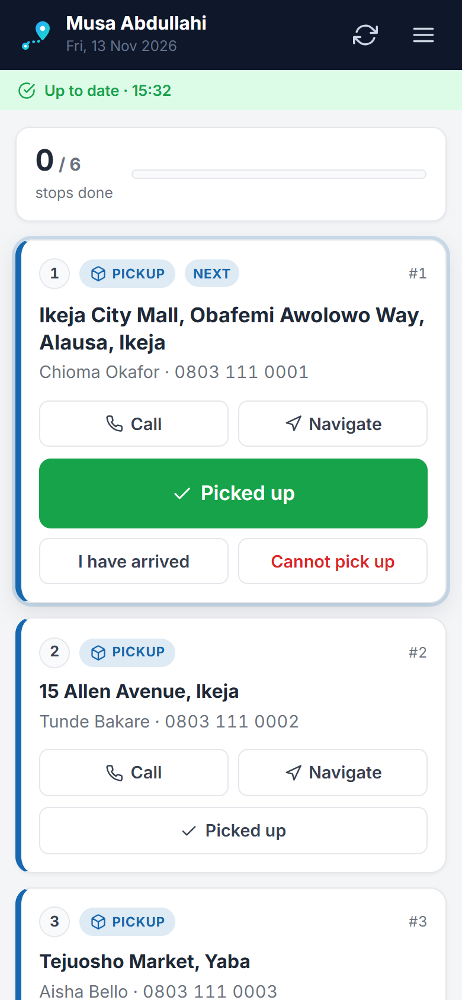
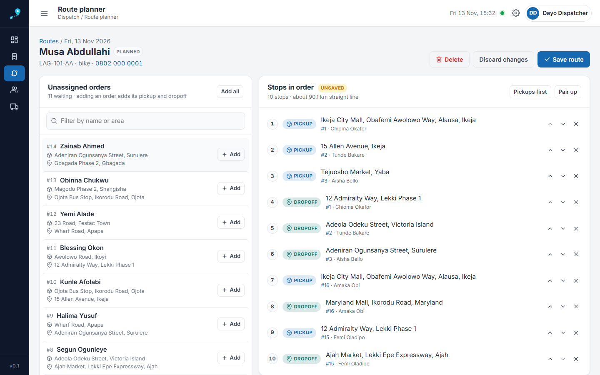
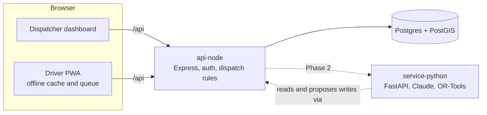

# Logistics Routing

Dispatch software for small and mid-sized courier companies in Nigeria.
It replaces the usual setup, where a dispatcher sends each driver their
jobs over WhatsApp and phone calls, with a web dashboard and an
installable driver app that keeps working when the network drops.

The project is being built in phases, from manual dispatch up to an
LLM-powered dispatch assistant, route optimization and live tracking.
**Phase 1, manual dispatch, is working.** Phase 2, the AI layer, is next.

| Dispatcher dashboard | Driver app (PWA) |
| --- | --- |
|  |  |



## What it does today

**Dispatchers** (web dashboard)
- Create orders with customer details, pickup and dropoff. With a Google
  Maps key, addresses come from Places search and fill the coordinates.
- Plan each driver's day by hand: add orders to a route, drag stops into
  order, and get warned about a dropoff placed before its pickup. The
  planner shows straight-line distance and a map of the route.
- Follow every order through a timeline built from the driver's updates.
- Manage drivers (with app PINs), vehicles and staff accounts. Admins set
  the Google Maps key from the Settings page.

**Drivers** (installable PWA at `/driver`, no app store)
- Log in with phone number and PIN and see today's stops in order, with
  call and navigate buttons.
- Mark stops arrived, picked up, en route, delivered, or failed.
- Keep working offline. The route is cached on the phone, and taps are
  queued with the time they happened and sent when the connection is back.

## Architecture



- **web**: React, TypeScript and Vite. One app serves the dashboard at `/`
  and the driver PWA at `/driver` (vite-plugin-pwa, Workbox).
- **api-node**: Express API, the only service the browser talks to. JWT
  auth for staff and drivers, zod validation, Postgres through `pg`.
- **Postgres with PostGIS**: locations stored as `GEOGRAPHY(POINT, 4326)`
  from day one, so the optimizer and live tracking need no migration.
- **service-python**: FastAPI, internal only, never exposed. It will hold
  the AI layer and route optimization.

### Design decisions worth a look

- **Offline updates are safe to retry.** Each tap carries a
  `client_event_id`, so a resend after a dropped connection is a no-op.
  The tap time is kept as the event time, and it's clamped in SQL so a
  phone with a wrong clock can't put events before the order's last one.
- **The same rules run on the phone and the server.** The driver app
  applies a tap locally with the API's rules, such as no dropoff before
  pickup, so the screen stays right while offline. The server checks the
  same rules again when the tap arrives.
- **Order and route status are derived.** Drivers only change stops. The
  order's status (assigned, picked up, en route, delivered) and the route's
  status follow from them, so the two can't disagree.
- **Tests get throwaway databases.** Each test file builds its own Postgres
  database from `db/init` and drops it afterwards, so tests can't touch dev
  data and test files can run in parallel.

## Roadmap

| Phase | Scope | Status |
| --- | --- | --- |
| 1. Manual dispatch | Auth, CRUD, manual routes, offline driver PWA, Lagos seed data | Done, real-phone test pending |
| 2. AI layer | WhatsApp message to validated order (Pydantic structured output), dispatch copilot agent with tool calls and human confirmation of every write, RAG over driver notes and SOPs with pgvector, evals in the repo | Next |
| 3. Route optimization | OR-Tools vehicle routing with pickup before dropoff, capacity and time windows, compared against the manual plan | Planned |
| 4. Live tracking | Driver location, WebSocket updates, live map, ETAs, customer SMS tracking link | Planned |
| 5. Traffic-aware routing | Road distances and durations, Lagos rush-hour profiles | Planned |
| 6. Multi-tenant SaaS | Row level security per company, Paystack billing | Planned |
| 7. Native driver app | React Native (Expo) for background location and push | Planned |

The full scope and exit criteria for every phase are in [CLAUDE.md](CLAUDE.md).

## Run it locally

Needs Docker and Node 22.

```sh
cp .env.example .env          # set JWT_SECRET to a long random string
docker compose up -d          # Postgres, api-node, Python placeholder
docker compose exec api-node npm run seed    # demo Lagos data

cd web
npm install
npm run dev                   # http://localhost:5173, /api goes to API_HOST_PORT
```

Demo logins:
- **Dashboard:** `dispatcher@example.com` or `admin@example.com`, password `password123`.
- **Driver app** at `/driver`: `08020000001` to `08020000005`, PIN `1234`.

Maps are optional. Without a key the app uses typed coordinates and a
route sketch. To turn maps on, sign in as admin and paste a Google Maps
browser key on the Settings page.

The service worker only runs in a production build, so test install and
offline mode with `npm run build && npm run preview`
(http://localhost:4173).

## Tests

```sh
docker compose up -d postgres
cd api-node && npm install && npm test
```

The API tests cover auth and roles, validation and phone normalisation,
the route rules, a full driver day with offline retries, and the settings
endpoints.

## Repository layout

```
api-node/         Express API (src/routes, scripts/seed.js, test/)
web/              React dashboard and driver PWA
service-python/   FastAPI service for Phase 2 and 3 (placeholder for now)
db/init/          Numbered SQL files, run in order on a fresh database
docs/             Screenshots
```

Endpoint reference: [api-node/README.md](api-node/README.md).
Web app notes: [web/README.md](web/README.md).
